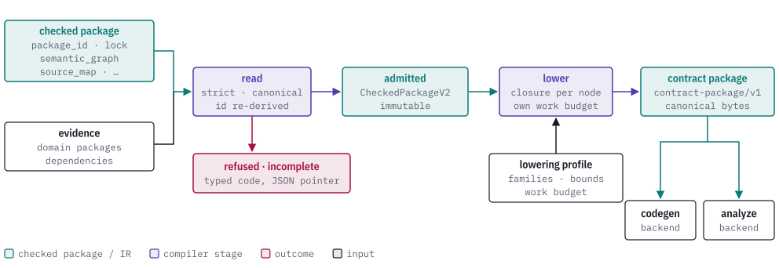
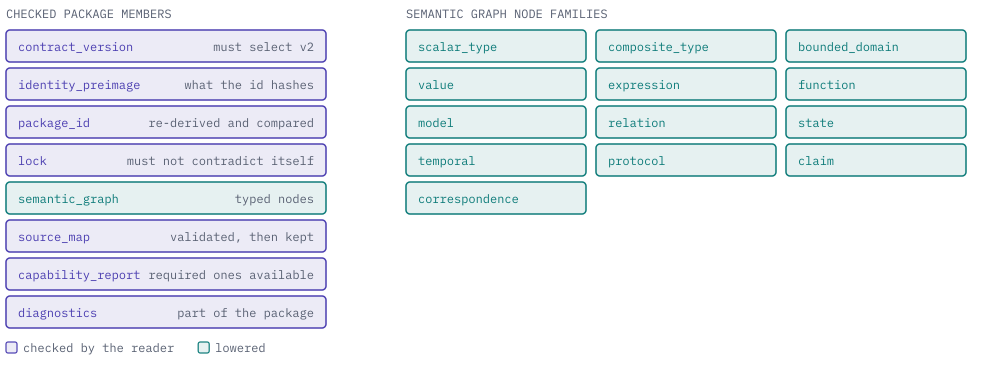
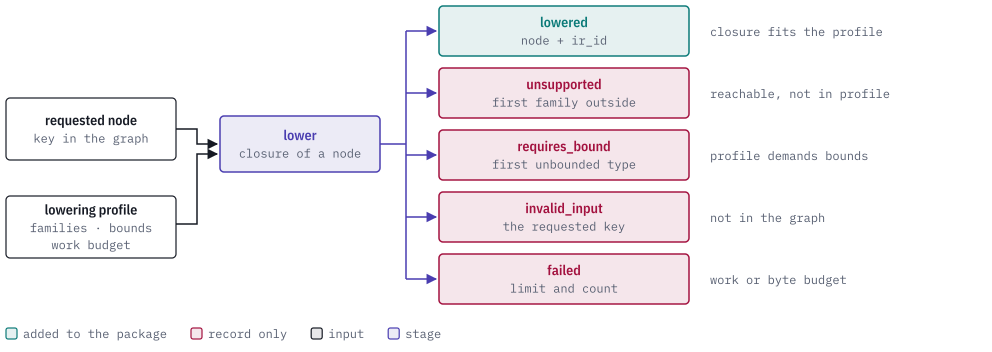

# Quire Contract IR

[](https://discord.gg/k8DVhuYBR2)

Contract IR is the target-neutral intermediate representation of a Quire
contract. This repository contains the reader for QSL checked packages and the
lowering that produces a canonical contract package.

It reads the `quire.checked-package/v2` JSON that QSL writes, validates it, and
lowers the parts a backend requests into one versioned contract package.
Code-generation and proof backends read that package. Input it cannot read or
lower ends as refused, unsupported or incomplete.

<picture>
  <source media="(prefers-color-scheme: dark)" srcset="docs/images/hero-dark.svg">
  
</picture>

> **Status: public prerelease.** The API is not stable yet, the crates are
> versioned `0.1.0` and are not published to a registry (`publish = false`), and
> the repository is developed spec-first.

## Reading

A `quire.checked-package/v2` has eight members. The reader checks every one: it
refuses a package whose `contract_version` is not `v2`, whose bytes are not
canonical JSON, whose `package_id` does not match the content it names, or whose
required capabilities are missing. Evidence the package names (the domain
package documents and any library packages it depends on) is handed in by the
caller; the reader recomputes digests itself and does not fetch anything.

<picture>
  <source media="(prefers-color-scheme: dark)" srcset="docs/images/inside-package-dark.svg">
  
</picture>

Reading has three outcomes:

| Outcome | Meaning |
| --- | --- |
| `Admitted` | The package is complete and immutable, and safe to lower. |
| `Refused` | The input is invalid, with a typed code (`malformed_wire`, `noncanonical_wire`, `stale_dependency`, `invalid_semantic_graph`, `unknown_contract_version` and others) and the JSON pointer of the value at fault. |
| `Incomplete` | The input exceeded a limit the caller set, so no conclusion was reached. |

## Lowering

Lowering takes the keys a backend asks for and a *lowering profile*: which node
families the backend supports, whether unbounded types must be bounded, and a
work budget. Each request is answered on its own, so one bad key never changes
the answer for another. Everything that lowered is assembled into a single
`quire.contract-package/v1` with canonical bytes and a package identity.

<picture>
  <source media="(prefers-color-scheme: dark)" srcset="docs/images/lowering-dark.svg">
  
</picture>

## Example

Read a package, then lower two keys, one of which is not in the graph. The
reader half is `read` in [`tests/it/checked_package_v2_reader.rs`](tests/it/checked_package_v2_reader.rs)
and the lowering half is in [`tests/it/checked_package_v2_lowering.rs`](tests/it/checked_package_v2_lowering.rs)
(`profile` and `tc_050_non_lowered_records_are_terminal_and_independent`); both
run under `make test`.

```rust
use quire_contract_model::{
    CheckedPackageEvidence, CheckedPackageReadLimits, CheckedPackageV2,
    CheckedPackageV2ReadResult, CompleteLoweringProfileV2, CompleteLoweringRecordV2,
    LoweringProfileRef,
};

// `bytes` are canonical checked-package bytes; `evidence` holds the domain
// package documents the package names.
let package = match CheckedPackageV2::read(&bytes, CheckedPackageReadLimits::bounded(), &evidence) {
    CheckedPackageV2ReadResult::Admitted(package) => package,
    other => panic!("expected V2 admission, got {other:?}"),
};

let profile = CompleteLoweringProfileV2 {
    reference: LoweringProfileRef {
        authority: "quire".into(),
        identity: "complete-v1".into(),
    },
    supported_tags: all_node_families, // a BTreeSet<CheckedNodeTag>
    require_bounds: false,
    work_limit: u64::MAX,
};

// `missing` is a node key that is not in the graph; `present` is one that is.
let result = package.lower(&[missing.clone(), present], &profile);
assert_eq!(
    result.records[0],
    CompleteLoweringRecordV2::InvalidInput { node_id: missing }
);
// records[1] is `Lowered`, and `result.package` holds only that node.
```

## Crates

The repository is a Cargo workspace with two packages and a one-way dependency.

| Crate | What it holds |
| --- | --- |
| `quire-contract-model` | The stable model: the checked-package reader, lowering, canonicalization, diagnostics, wire checks, limits, bindings and the conformance runner. Owner crates depend on this package alone. |
| `quire-contract-ir` | The root crate, which depends on the model and adds the versioned bounded-Kani interface (`quire_contract_ir::kani`: profile, finite-input ABI, dispatch index and outcome types). It re-exports no model item; take those from `quire_contract_model`. It also builds the `quire-contract-conformance` binary. |

### Conformance corpus

`corpus/contract-v0.1` is a language-neutral corpus of fixtures with expected
results, and `schemas/` holds the JSON schemas it is checked against. Run it
without linking the Rust library:

```bash
quire-contract-conformance run --corpus corpus/contract-v0.1 --schemas schemas
```

The runner writes one JSON line per fixture and exits `0` when all match, `1`
when any fixture mismatches and `2` on an invalid invocation or corpus.
`make corpus` runs the same command through cargo. See
[`corpus/contract-v0.1/README.md`](corpus/contract-v0.1/README.md) and
[`schemas/README.md`](schemas/README.md).

## Quire ecosystem

<picture>
  <source media="(prefers-color-scheme: dark)" srcset="docs/images/ecosystem-dark.svg">
  
</picture>

Contract IR sits in the main chain, between the compiler and the backends.
It reads the checked packages that [quire-spec-language](https://github.com/agent-ix/quire-spec-language)
writes, and its model is what code generation
([quire-contract-codegen](https://github.com/agent-ix/quire-contract-codegen))
and analysis ([quire-analyze](https://github.com/agent-ix/quire-analyze)) work from.
The model crate depends on
[quire-canonical](https://github.com/agent-ix/quire-canonical) for canonical
JSON and digests, [quire-walk](https://github.com/agent-ix/quire-walk) for
iterative walks over deep terms, and
[quire-verification-contracts](https://github.com/agent-ix/quire-verification-contracts)
for the checked-operation catalogue.

## Building and testing

```bash
make test           # cargo test over the workspace, plus doctests
make lint           # clippy with -D warnings
make corpus         # the conformance corpus
make ci             # every local gate: fmt-check, lint, test, corpus, spec, deny, audit
make help           # all targets, including the lanes that need a QSL or QSpec checkout
```

Some conformance lanes (`make conformance-qspec`, `conformance-qsl-ir769` and
others) need a checkout of `quire-specification` (private) or
`quire-spec-language` and are outside `make test`; `make help` names what each
one needs.

## Contributing

Every contribution needs a signed Contributor License Agreement, which the CLA
bot walks you through on your first pull request. Requirements and acceptance
criteria are updated before implementation, and the repository's specification,
review and test gates must pass. See [CONTRIBUTING.md](CONTRIBUTING.md) and
[CLA.md](CLA.md).

## License

Licensed under the GNU Affero General Public License, version 3 or (at your
option) any later version (`AGPL-3.0-or-later`). See [LICENSE](LICENSE).
