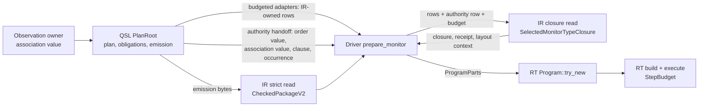

# Tick-monitor admission, lowering and execution pipeline

## System Boundary

In scope: one timed claim's tick-monitor plan, from QSL's final `PlanRoot`
emission to a runtime monitor executing events, watermarks and gaps. Five
repositories take part. Each owns one stage and one public seam; no stage
reads another stage's private representation, re-derives its meaning, or
supplies a missing fact by callback, copy or default.

Out of scope: plan derivation and temporal meaning (QSL FR-251, ADR-026),
the checked-package wire (QSpec FR-487, FR-322), observation progress
admission (observation FR-004), code generation, and the hardware acquisition
of readings. Each is consumed by reference.

## Views

The views give the owning component of each stage, the data flow between
them, the public seams, plan identity, the one preparation budget and the
component dependencies.

### Components and owners

| Component | Repository | Owns |
| --- | --- | --- |
| Plan producer | `quire-spec-language` | `PlanRoot`: the plan, timing obligations and final `Emission`; same-emission witness rows; budgeted row adapters; the canonical model-step order value; the same-emission authority handoff with the observation association value. |
| Observation owner | `quire-observation` | Progress association rows with structural node and claim identities, and their canonical association value. |
| Contract IR | `quire-contract-ir` (model crate) | Strict admission; `CheckedMonitorPlanRef`; the atomic selected closure with its authority receipt and layout context; the shared `NativeJoinBudget`. |
| Driver | `quire-driver` | `prepare_monitor`: independent selection, the one preparation budget, lowering into `ProgramParts`, the call to `Program::try_new`. |
| Runtime | `quire-contract-runtime` | `Program` construction and its bounded scratch; `build`, `event`, `watermark`, `gap` and `poll` under `StepBudget`; bounded state. |

### Data flow

1. QSL emits one `PlanRoot` for an independently selected clause and target.
   Its accessors are read-only; its `Emission` carries the plan-root bytes
   and every witness row of the same acquisition.
2. The driver strictly reads the emission into one `CheckedPackageV2` and
   compares it with the independently selected package instance.
3. The driver obtains same-emission rows through QSL's budgeted adapters,
   which return IR-owned row types, and QSL's authority handoff, which it
   translates unchanged into `SelectedMonitorAuthorityRow`.
4. IR's one closure read checks authority, joins every reached row, projects
   Exact and nominal facts, reads admitted equality decisions, and returns
   the closure, the receipt and the layout context, or one typed refusal.
5. The driver lowers the four entries' reachable closure into the RT function
   and expression arenas, builds the canonical `TypeEnvironment` and `Layout`,
   and moves them into `Program::try_new`.
6. RT validates the parts and returns `Rc<Program>`; `build` allocates fresh
   state under `StepBudget` and runs `init`; the monitor then executes
   admitted inputs.

### Public seams

| Seam | Provider | Consumer | Contract |
| --- | --- | --- | --- |
| Emission bytes and witness rows | QSL | IR, driver | QSL FR-251 Outputs; FR-038 strict reader. |
| Budgeted row adapters returning IR-owned rows | QSL | driver | Each takes the caller's `&mut NativeJoinBudget`, charges before every owned allocation, and on denial returns the IR denied charge and locus unchanged with no rows (driver FR-019 seam table). |
| Same-emission authority handoff | QSL (with the observation owner's value) | driver | QSL FR-251-AC-45 through AC-48; components listed in FR-361 Inputs. |
| `SelectedMonitorAuthorityRow`, closure read, receipt and layout context | IR | driver | FR-357, FR-361. |
| `NativeJoinBudget` `resume` and `accounted_charge` | IR | QSL adapters, driver | FR-358. |
| `ProgramParts`, `Program::try_new` | RT | driver | RT interface-002, FR-276. |
| `BuildPlan`, `StepBudget`, entry dispatch | RT | caller | RT interface-003, interface-012, FR-276. |

### Plan identity

The plan's identity is its resolved root content key. That key covers the
four entries, every premise and the helper call closure (QSpec FR-487). The
driver retains it as `Layout.root` together with the four entry keys and the
independently selected lock, clause, subject and occurrence. QSL's `PlanId`
is source metadata and is not read. No stage adds a second identity, digest
or hash.

### One preparation budget

One caller-owned finite `NativeJoinBudget` covers preparation from the first
driver selection charge to the last `ProgramParts` allocation. Each phase
starts with `resume`, which keeps every admitted charge and the original
limits:

| Phase | Charger | Charged before |
| --- | --- | --- |
| P1 selection | driver | final-subject comparisons, partial selection, clock admission |
| P2 identity rows | QSL `identity_rows` | the native join and each owned record, member and union allocation |
| P3 row adapters | QSL adapters | equality witness rows, source enum rows, model enum shape rows, collection rows |
| P4 authority row | driver | copying the order and association bytes |
| P5 closure | IR | every inspection, join, projection, receipt and context allocation |
| P6 lowering | driver | every arena, environment, layout and diagnostic allocation |

A denial anywhere returns the first unpaid kind, attempted amount and
non-owning locus, with no partial result and no reset. Cancellation is
polled between phases and is not a budget event. The preparation budget ends
when the driver moves the complete `ProgramParts` into `Program::try_new`.
RT construction then uses its own scratch bound, and `build` and every step
use the caller's `StepBudget`. Plan capacities are semantic premises, not
operating budgets, and are never changed by either budget.

### Component dependencies

Each component consumes only the public seams named here.

| Component | Consumes |
| --- | --- |
| Observation owner | Nothing in this pipeline. |
| Plan producer (QSL) | The observation owner's association value and its structural identities; IR's `NativeJoinBudget`, `NativeJoinLocusSource` and IR-owned row types for its budgeted adapters. |
| Contract IR | The emission bytes it strictly reads; the IR-owned rows and authority row supplied to the closure read. It consumes no QSL, observation or runtime type. |
| Driver | QSL's `PlanRoot` accessors, adapters and authority handoff; IR's strict reader, closure read, receipt, layout context and budget; RT's `ProgramParts` and `Program::try_new`. |
| Runtime | `ProgramParts` and the caller's `StepBudget`. It consumes no IR, QSL or driver type. |

A component's IR-owned criteria that use only fixtures need nothing from
another component; each genuine producer-to-runtime criterion needs every seam
it crosses.

## Decisions

- The closure read is the single place where same-emission authority meets
  the admitted package, so a receipt cannot exist without a complete closure.
- IR checks only admitted structural correspondence. Order and association
  values stay opaque bytes owned by QSL and the observation owner, and IR
  takes no QSL, observation or runtime dependency.
- IR supplies the canonical clock-binding value and the lock and occurrence
  bytes, because it owns the admitted facts they encode.
- The driver's private operating ledger is replaced by the shared
  `NativeJoinBudget`; storage is counted in that budget's logical units with
  no release.

## Risks

- The canonical clock-binding member set for `model-time` is fixed here from
  QSpec FR-252's key components; a published QSpec encoding would supersede it.
  Owner: Contract IR lane. Review when QSpec publishes a clock-binding value.
- RT construction validates parts linearly without a separate meter; its
  bound depends on part sizes that the preparation budget has already
  bounded. Owner: Runtime lane.
